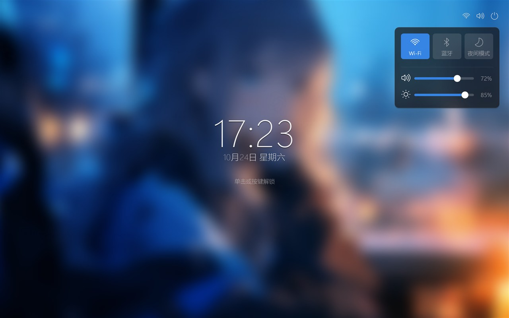

# Ubuntu Lock Saver

仿 Ubuntu GNOME 锁屏的 Windows 屏幕保护程序。模糊壁纸（不压暗）、大号 24 小时制时钟、本地化日期，带淡入淡出、分钟数字交叉淡变和壁纸缓慢缩放动画。

An Ubuntu-style lock screen screensaver for Windows: blurred undimmed wallpaper, large 24-hour clock, localized date, fade in/out, minute cross-fade and a slow Ken Burns zoom.



## 下载 / Download

在 [Releases](../../releases) 下载 `UbuntuLockSaver.exe`，放到任意目录后运行一次安装命令：

```powershell
UbuntuLockSaver.exe /install
```

安装是**当前用户级**的，不需要管理员权限，也不会弹出控制台窗口：

- 把程序复制到 `%LOCALAPPDATA%\UbuntuLockSaver\UbuntuLockSaver.scr`
- 写入 `HKCU\Control Panel\Desktop` 的 `SCRNSAVE.EXE`、`ScreenSaveActive`
- 保留原有的等待时间与"恢复时显示登录界面"设置

卸载并恢复安装前的屏保设置：

```powershell
UbuntuLockSaver.exe /uninstall
```

也可以把 Release 中的 `UbuntuLockSaver.scr` 手动放进 `C:\Windows\System32`，再在
`控制面板 → 外观和个性化 → 屏幕保护程序` 中选择。

## 命令行参数 / Command line

| 参数 | 说明 |
|---|---|
| `/s` | 全屏运行屏保 |
| `/c` | 打开设置说明窗口（直接双击 exe 的默认行为） |
| `/p <hwnd>` | 在系统屏保设置的小预览窗口中运行 |
| `/install` | 静默安装到当前用户 |
| `/uninstall` | 静默卸载并恢复原有设置 |

## 构建 / Build

需要 Windows 自带的 .NET Framework 4.x 编译器（无需安装 SDK）：

```powershell
powershell -ExecutionPolicy Bypass -File build.ps1
```

产物为 `dist\UbuntuLockSaver.exe` 与 `dist\UbuntuLockSaver.scr`（同一个程序，仅扩展名不同）。

## 行为说明 / Behavior

- 空闲等待、是否在恢复时锁定，由 Windows 屏幕保护程序设置控制。
- 单击、任意按键都会退出；右上角状态图标可打开快捷设置面板，Esc 先关闭面板。
- 壁纸不添加黑色遮罩，文字使用柔和投影保证可读性。
- 多显示器：每个屏幕一个全屏窗口。

## 限制 / Limitations

- 不能替代 `Win+L` 的安全锁屏（LogonUI）；这是普通屏幕保护程序。
- 未签名的本地 `.scr` 可能触发杀毒软件提示，源码可直接审查。
- 使用 .NET Framework 4.8（Windows 10/11 自带）。

## 许可 / License

未附带许可证文件；如需开源发布请自行选择并添加。
